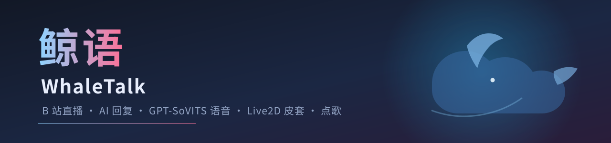

<p align="center"></p>

# 鲸语 WhaleTalk

> 把 B 站 / 抖音直播间变成会说话、有表情的 AI 主播。
> 读弹幕 → Qoder 大模型写回复 → GPT-SoVITS 合成语音 → Live2D 皮套对口型播放，还能点歌。

鲸语（WhaleTalk）是一个跑在 Windows 本机的开源直播助手：

- 实时读取 **B 站 / 抖音** 直播间的 **进房 / 弹幕 / 礼物 / 上舰（粉丝团）/ 醒目留言 / 关注 / 点赞**
- 交给 **Qoder 大模型**（或任意 OpenAI 兼容接口、或固定模板）生成口语回复
- 用本机 **GPT-SoVITS** 合成你的音色，直接播放，并驱动 **Live2D** 皮套对口型、换表情
- 自动把回复显示成 **皮套头顶的气泡**，或输出到 OBS 字幕源
- **点歌**：送指定礼物领点歌券，弹幕 `点歌:歌名` 自动搜索网易云并排队播放，送插队礼物可置顶
- **AI 游戏**：可互动（猜数字/数字炸弹/抢答/词语接龙/投票/贪吃蛇/扫雷/2048）与
  单人节目（冷知识/故事连载/脑筋急转弯/讲笑话），支持自动轮换与积分榜，一个人播也不冷场
- 完整可配置：每种事件单独开关、冷却、合并、模板、情绪映射……

> 名字里的「鲸」来自默认参考皮套 DS 鲸鱼娘（皮套不随仓库分发，见下文），「语」是它替你说出口的话。

<p align="center">中文 · <a href="#english">English</a></p>

---

## 目录

- [功能](#功能)
- [它是怎么工作的](#它是怎么工作的)
- [快速开始](#快速开始)
- [抖音直播模式](#抖音直播模式)
- [在直播软件里使用](#在直播软件里使用)
- [固定话术烘焙](#固定话术烘焙)
- [点歌](#点歌)
- [AI 游戏](#ai-游戏)
- [Live2D 皮套与气泡](#live2d-皮套与气泡)
- [配置说明](#配置说明)
- [常见问题](#常见问题)
- [从源码运行 / 打包](#从源码运行--打包)
- [仓库里没有什么](#仓库里没有什么)
- [合规与致谢](#合规与致谢)

---

## 功能

| 模块 | 说明 |
|---|---|
| 弹幕读取 | B 站：官方网页 WebSocket，实时接收进房、弹幕、礼物、上舰、醒目留言、关注、点赞；扫码登录后观众名字不再打码<br>抖音：借用本机浏览器的 DevTools 协议读取直播间页面消息（或接收外部工具转发），不需要开放平台账号 |
| AI 回复 | 默认调用 Qoder CLI（你 Qoder 账号的额度，常驻会话会记得上下文）；也可切到 OpenAI 兼容 API；AI 出错自动退回模板 |
| 语音合成 | 本机 GPT-SoVITS（v2Pro / 微调模型均可），自动启动引擎、切换权重、按音量包络驱动口型 |
| 话术烘焙 | 一键把固定台词（游戏台词、静态模板/固定回复、自定义开场白）预合成成本机 wav；再播到同一句直接读缓存，不再等合成 |
| Live2D 皮套 | 浏览器源输出透明背景；自动呼吸/眨眼，说话时对口型，按回复内容自动切换表情与动作 |
| 气泡字幕 | 皮套头顶气泡，大小随文字自适应、逐字显示；OBS 字幕页可选 |
| 点歌 | 网易云搜索 + 可播放判断 + 相似版本回退；点歌券/插队券；歌单队列与置顶；说话时自动压低音乐 |
| 固定回复 | 弹幕命中关键词直接念固定内容，可指定表情，不消耗 AI |
| 情绪系统 | AI 自己为回复挑一个情绪（开心/感谢/害羞/惊讶…），模板与固定回复按关键词判断 |
| 群控细节 | 礼物连击合并、多人进房合并、同观众冷却、屏蔽词、优先级队列、过期消息丢弃 |
| 本场数据 | 已用 Token（文字前缀可自定义，AI 没返回用量时按字数估算并标 ≈）、本场直播时长（断开暂停、重连累加）、本场礼物件数/总价值与逐条记录，可一键重置；同一个数据可以直接作为浏览器源显示在直播画面上（`/stats`） |
| 开播总开关 | 打开软件默认一切就绪但不动作；点「开始」按设置启动连接 / 语音引擎 / 自动歌单 / 游戏轮换，点「停止」全部停下（设置不变）；可勾选开机自动开始 |
| 界面 | 内嵌 WebView2 的原生窗口（没有地址栏/标签页，不弹浏览器）；设置即时保存、日志实时显示；系统缺 WebView2 时自动退回 Edge 应用窗口 |

## 它是怎么工作的

```
┌─────────────┐   WebSocket    ┌──────────────┐   过滤/合并/排队   ┌───────────────┐
│ B 站直播间  │ ─────────────► │  bili.py     │ ─────────────────► │ pipeline.py   │
└─────────────┘                └──────────────┘                    └───────┬───────┘
                                                                          │ 事件
                                        ┌─────────────────────────────────┤
                                        ▼                                 ▼
                                 ┌─────────────┐                   ┌─────────────┐
                                 │ songs.py    │                   │ brain.py    │
                                 │ 网易云点歌  │                   │ Qoder / API │
                                 └──────┬──────┘                   └──────┬──────┘
                                        │ 音乐                            │ 文本+情绪
                                        ▼                                 ▼
                                 ┌─────────────────────────────────────────────┐
                                 │ tts.py  GPT-SoVITS 合成 + 混音播放器        │
                                 │ （音乐与语音同一条音频流，说话时压低音乐）  │
                                 └──────────────────┬──────────────────────────┘
                                                    │ speak / envelope / emotion
                                    ┌───────────────┴───────────────┐
                                    ▼                               ▼
                          ┌──────────────────┐            ┌──────────────────┐
                          │ web/live2d.html  │            │ web/songs.html   │
                          │ 皮套 · 口型 · 气泡│            │ OBS 歌单         │
                          └──────────────────┘            └──────────────────┘
```

所有页面都是本机 `127.0.0.1:8787` 上的普通网页，通过 WebSocket 接收同一个事件流，所以可以同时开在 OBS、直播姬和浏览器预览里，互不干扰。

## 快速开始

> 目前仅支持 Windows 10/11 + NVIDIA 显卡（GPT-SoVITS 需要 CUDA）。CPU 也能跑，但合成会慢很多。

### 需要准备

1. **Qoder**：登录 [Qoder](https://qoder.com)，安装 Qoder CLI 并登录
   ```powershell
   irm https://qoder.com/install.ps1 | iex
   qodercli login
   ```
   （也可以在软件目录双击 `qoder_login.bat`；不想用 Qoder 就在设置里切到 OpenAI 兼容接口。）
2. **GPT-SoVITS**：下载官方 Windows 整合包（本项目只调用它的 `api_v2.py`），例如 `GPT-SoVITS-v2pro-*`
3. **参考音频**：3~10 秒干净人声 + 一字不差的文字；或自己微调的 GPT/SoVITS 权重
4. **Live2D 模型**（可选）：Cubism 3/4 的 `.model3.json` 模型，VTube Studio 用的那种即可
5. **WebView2 运行时**（界面窗口用）：Win10/11 一般自带；没有会自动退回 Edge 应用窗口，不影响功能

### 三步跑起来

1. 启动 `WhaleTalk.exe`：会打开一个**独立应用窗口**（内嵌 WebView2，没有地址栏/标签页，首次约 5 秒）。
   不再弹黑色控制台窗口，日志在 `logs/app.log`
2. 在【语音设置】选 **GPT-SoVITS 目录**、**参考音频**、**参考音频文本**，点【试听】
3. 在【直播间 / 登录】选弹幕来源：
   - **B 站**：填房间号 →【扫码登录】（建议小号，仅用于拿观众昵称）
   - **抖音**：填直播间链接或房间号 →【保存并连接】，在弹出的浏览器窗口里登录抖音

之后点控制台顶部的 **「开始」**，才会按设置启动：连接直播间、启动语音引擎、自动歌单、游戏轮换。
默认不自动开始（想开机即连就在同一张卡片里勾「打开软件时自动开始」）。
【控制台】右下角的“模拟测试”不需要真实观众就能试全流程。

## 抖音直播模式

抖音网页版的弹幕走的是需要 `signature` 的私有 WebSocket，纯 Python 复现两天就过期一次。
所以这里不自己签名，而是**让浏览器去连**：用本机 Edge / Chrome 打开你的直播间，
通过 DevTools 协议把页面里新增的弹幕、礼物、进场、关注、点赞文本读出来，再归一化成内部事件。

```
抖音直播间网页（独立浏览器窗口，自带登录态）
        │  新增的聊天行
        ▼
注入脚本（MutationObserver）→ window.__wtQueue
        │  Runtime.evaluate 轮询
        ▼
douyin.py 文本识别 → 进房/弹幕/礼物/粉丝团/关注/点赞 → 和 B 站走同一条 pipeline
```

- 不需要抖音开放平台账号、不调用私有接口、不改动你自己平时用的浏览器
- 浏览器用独立数据目录 `douyin_profile`，第一次登录后一直记住
- 窗口带 `--mute-audio`，不会把直播间原声放出来盖住 AI 语音
- 礼物价格表可配置（`礼物名=抖币`，10 抖币 = 1 元），用来判断付费礼物与最低价值
- 抖音的“加入粉丝团”归到上舰/粉丝团事件，模板变量 `{guard}` 为“粉丝团”
- 点歌的礼物名默认还是 B 站的（小花花 / 人气票），播抖音时到【点歌】里改成抖音礼物（如小心心）
- 抓不到时可以看【抖音直播间】卡片里的原始消息预览；出现“忽略”说明文本没被识别
- 另有 **relay 转发模式**：不打开浏览器，由任意弹幕工具推到
  `POST /api/douyin/ingest`（需带请求头 `X-BVB: 1`）或 `ws://127.0.0.1:8787/ingest/douyin`
  （`type` 支持 `danmaku / gift / enter / follow / like / guard`）

> 说明：这种方式依赖抖音网页的页面结构，平台改版可能需要更新识别规则；走的是非官方途径，
> 请自行评估账号与平台规范风险。

## 在直播软件里使用

| 用途 | 浏览器源地址 | 建议尺寸 |
|---|---|---|
| Live2D 皮套 | `http://127.0.0.1:8787/live2d` | 1080×1080，背景透明 |
| 头顶气泡 | （包含在皮套页里） | — |
| 点歌列表 | `http://127.0.0.1:8787/songs` | 540×480，背景透明 |
| 游戏面板 | `http://127.0.0.1:8787/game` | 760×700，背景透明（含小游戏棋盘） |
| 本场数据条 | `http://127.0.0.1:8787/stats` | 520×280，背景透明（Token / 时长 / 礼物） |
| 纯字幕 | `http://127.0.0.1:8787/overlay` | 1280×200，背景透明 |

- 直播软件不支持透明网页时，用绿幕再抠像：`/live2d?bg=00ff00`
- 软件退出或被结束后，这些页面会自动隐藏（正常退出立即隐藏，强制结束最多 5 秒）
- 声音由本程序播放，直播软件开启“桌面音频/系统声音”采集即可

### 本场数据条（`/stats`）

把控制台里的「本场数据」直接放进直播画面：Token 用量、本场已播时长、礼物件数/总价值，以及最近几条礼物记录。

- 在【OBS 字幕】页最下方可以改：标题、位置（四个角）、字号、显示哪几项、礼物记录条数；改完约 5 秒内自动生效
- Token 数字前面的文字仍在【控制台】的 Token 卡片里改（`stats.token_label`）
- 也可以临时用 URL 参数覆盖：`/stats?fs=30&pos=top-right&rows=6`
- 默认左上角、透明背景；样式是深色半透明胶囊，白字带描边阴影，压在任何画面上都能看清
- 时长在浏览器本地每秒走表，不需要频繁请求；软件断开后整块自动隐藏

## 固定话术烘焙

固定台词每次都现场合成太浪费——尤其游戏的开场、倒数、结算。到【语音设置】最下方点
**一键烘焙固定话术**，程序会用当前音色把这些台词先合成成 wav 存到软件目录的 `tts_cache/`，
之后播到同一句就直接读文件（约 0 延迟），不再占引擎。

- 自动收集：`games.py` 里 `self._say / _say_wait` 的纯固定台词、回复规则里不含变量的模板、
  固定回复里不含变量的回复
- **按变量拆段**（`tts.segment_bake`，默认开）：带 `{name}` `{num}` `{gift}` 的台词会拆成
  「固定片段 + 变量」，固定片段读缓存、只把名字/数字等变量现场合成再拼起来（拼接处 25ms 间隙）。
  模板来源：事件模板、固定回复、点歌播报、游戏里的 f-string 台词，大约 100+ 个固定片段。
  觉得拼接痕迹明显就在【语音设置】关掉这个开关，退回整句合成。
- 自定义：`tts.bake_extra`（一行一条），适合开场白、结束语、口头禅
- 缓存按「文字 + 音色签名」匹配；换了模型、参考音频、语速、温度、采样步数后旧缓存自动失效，
  界面会提示“N 条音色已变，需要重新烘焙”
- `tts_cache/index.json` 记录清单，可随时【清空缓存】；缓存目录在 `.gitignore` 里，不会进仓库
- 烘焙是串行占用语音引擎的，建议不在直播中操作；直播中烘焙只是慢一点，正常说话不受影响

## 点歌

1. 观众送**点歌礼物**（默认：小花花）→ 获得点歌券
2. 观众发弹幕 `点歌:歌名`（也支持 `点歌 歌名 歌手`）
3. 程序搜索网易云：原版能播就播原版，否则自动挑一首能完整播放的相似版本并播报
4. 送**插队礼物**（默认：人气票）→ 他排队中的歌立刻置顶；还没点歌的话下一首直接置顶

在【点歌】页可以改礼物名与数量、上限、音量、压低比例、播报文案，也能暂停/切歌/调序/删除、手动点歌、给观众补券。
登录**网易云账号**（扫码或粘贴 `MUSIC_U`）后，VIP 歌曲也能完整播放。

## AI 游戏

一个人守着皮套太无聊时，让 AI 自己开一局。分两类，语音与皮套表情照常走：

| 类别 | 游戏 | 参与方式 |
|---|---|---|
| 可互动 | 猜数字 | 发 1~100 的数字，AI 提示“大了/小了”，猜中得 3 分 |
| 可互动 | 数字炸弹 | AI 埋一个炸弹，轮流报数缩小范围，踩中的人被炸飞，其他人得逃生分 |
| 可互动 | 抢答问答 | AI 出题，第一个答对的得 3 分 |
| 可互动 | 词语接龙 | 用上一个词最后一个字开头，接一个得 1 分 |
| 可互动 | 观众投票 | 二选一，支持第一个发 1、第二个发 2，公布票数 |
| 可互动 | AI 贪吃蛇 | AI 自己找食物，观众发 上/下/左/右 帮它转向，喂到食物得分 |
| 可互动 | AI 扫雷 | AI 推理翻格，观众发 `3,5` 帮它翻第 3 行第 5 列，翻到安全格得分 |
| 可互动 | 2048 | AI 算方向，观众发 上/下/左/右 指挥，合出 64 以上新数字得分 |
| 可互动 | 猜拳对决 | 发 石头/剪刀/布 挑战 AI，赢一局 2 分、平局 1 分；出法支持“我出布”“剪刀”等说法 |
| 可互动 | 幸运抽奖 | 发 1 报名，倒计时结束抽 1~5 位（可调），中奖各加 5 分 |
| 可互动 | 飞花令 | AI 定令字（春/月/花/风…），观众发含这个字的诗句，一句 1 分，不能重复 |
| 不可互动 | 冷知识 / 故事连载 / 脑筋急转弯 / 讲笑话 | AI 自己讲，观众听着就行 |

- 【AI 游戏】页可手动“开始”任意一局，也能勾“自动轮换”：连着直播间时，有人聊天就优先互动游戏，
  安静时播单人节目；每局之间默认歇 180 秒。
- 互动游戏只接住参与类弹幕，其他聊天照常回复；单人节目期间普通弹幕会暂时跳过（礼物、SC 不受影响）。
- 积分榜在本次运行中累计；`/game` 浏览器源把题目、倒计时、票数、接龙和积分显示到直播画面。
  贪吃蛇、扫雷、2048 会直接显示棋盘或方块，没人操作时 AI 自动继续玩。
- 小游戏参数在【AI 游戏】页可调：贪吃蛇速度、扫雷雷数、抽奖时长与中奖人数、AI 操作间隔。

## Live2D 皮套与气泡

- 默认“站着不动”，只保留呼吸与眨眼；可另开“头部轻微摆动”和“待机动作”
- 说话时按真实音量张开嘴，句末自然闭合
- 回复的**情绪**会映射到表情/动作，映射表可增删改，所有表情动作都能一键试播
- 气泡位置、字号、宽度、配色、停留时间均可调

表情建议这样配（默认已配好一套）：

| 情绪 | 表情 | 触发倾向 |
|---|---|---|
| 开心 | 开心兴奋 | 哈哈、太好了、欢迎 |
| 感谢 | 爱心眼 | 谢谢、礼物、上舰 |
| 害羞 | 脸红 | 被夸、不好意思 |
| 惊讶 | 感叹号 | 哇、居然、上舰 |
| 调皮 | 吐舌 + 泡泡糖动作 | 嘿嘿、才不 |
| 疑惑 | 问号 | 为什么、咦 |

## 配置说明

所有设置都在界面上，保存在软件目录的 `config.json`（含 B 站/网易云登录信息，**不要外传**）。
重点项：

| 位置 | 项目 |
|---|---|
| 界面 / 窗口 | `ui.native`（默认开 = 内嵌 WebView2 原生窗口；关掉 = Edge 应用窗口）、窗口宽高；`--browser-ui` 启动参数可临时强制用浏览器窗口 |
| 开播总开关 | `session.auto_start`（打开软件是否自动开始）；单个启动项仍由自动连接 / 自动启动引擎 / 自动轮换 / 自动歌单各自的开关决定 |
| 直播间 / 登录 | 弹幕来源（B 站 / 抖音）、B 站房间号与扫码登录、抖音房间与抓取方式、浏览器路径/端口、礼物价格表 |
| 回复规则 | 每种事件的开关、AI/模板、冷却、合并窗口、触发词、概率、模板变量 |
| 固定回复 | 关键词 → 固定话术（包含/完全一致/正则），可指定表情 |
| 点歌 | 礼物换券、上限、音量与压低、播报文案、网易云登录 |
| AI 游戏 | 总开关、自动轮换与间隔、每个游戏的启用、猜数字提示次数、贪吃蛇速度、扫雷雷数、AI 操作间隔 |
| AI 设置 | 后端、模型（可一键列出账号可用模型）、**接口模式**（Responses / Chat Completions，可一键测试）、**思考程度**（默认/关闭/低/中/高/自动）、人设、字数上限、会话重开频率 |
| 语音设置 | 引擎目录/地址、GPT/SoVITS 权重、参考音频与文本、语速、采样步数、输出设备、音量、固定话术烘焙与缓存管理 |
| Live2D 皮套 | 模型、位置缩放、呼吸/眨眼/摆动/口型、常驻表情、情绪映射、气泡样式 |

模板变量：`{name}` `{text}` `{gift}` `{num}` `{value}` `{guard}` `{price}`；点歌播报另有 `{song}` `{artist}` `{pos}` `{query}`。

## 常见问题

- **回复全是模板？** 看“AI 回复”里的来源与原因；多数是 Qoder CLI 未登录（运行 `qoder_login.bat`）
- **提示“Qoder 超时…仍在服务端排队/服务繁忙”？** 多半是思考程度选了低/中/高：
  这些档位会带 `--reasoning-effort`，走 Qoder 的推理队列，高峰期可能一直排队到超时；
  把【AI 设置→思考程度】改回“跟随模型默认”或“关闭”通常几秒就能回复，
  或把【AI 设置→超时秒数】调到 120 秒以上继续等。直播中不想卡住就保持 30~60 秒，超时后用模板兜底
- **没声音？** 语音引擎是否“在线”、参考音频是否选、音量是否为 0、输出设备是否正确
- **观众名字是“新朋友”？** 未登录 B 站时名字被打码；扫码登录即可
- **B 站登录显示无效？** 看控制台里的提示（如 `-101 账号未登录` 表示 Cookie 过期）
- **OpenAI 接口报 404 / 用不了？** 【AI 设置】里换「接口模式」：部分服务只有 Chat Completions，没有 Responses；点【测试接口】会直接告诉你哪种可用
- **点歌放的不是原唱？** 原版无版权/需 VIP 时会自动找相似版本；登录网易云 VIP 后可放原版
- **界面是浏览器吗？** 不是。默认用内嵌 WebView2 的原生窗口，没有地址栏和标签页；系统缺 WebView2 或加 `--browser-ui` 时才用 Edge 窗口
- **打开软件后什么都没动？** 这是正常的：默认不自动开播，点控制台顶部「开始」才会连直播间、启动语音/歌单/游戏
- **抖音没抓到弹幕？** 先看浏览器窗口里抖音是否已登录、弹幕是否在滚动，再看【抖音直播间】里的抓取状态与原始消息预览
- **关掉程序画面还留着？** 新版会自动隐藏；若仍残留，刷新直播软件里的浏览器源

更多见 [docs/使用教程.md](docs/使用教程.md)。

## 从源码运行 / 打包

```powershell
# Python 3.12
uv venv --python 3.12 .venv
.venv\Scripts\pip install -r requirements.txt

.venv\Scripts\python main.py          # 直接运行（会打开内嵌窗口）
.venv\Scripts\python main.py --browser-ui   # 用 Edge 窗口打开（排查窗口问题时用）
build.bat                              # 打包成 dist\WhaleTalk.exe（需要 requirements-dev.txt）
# 手动打包时别忘了：--add-data "web;web" --add-data "games.py;srcdata"
#                  --collect-all webview --hidden-import clr（内嵌窗口依赖）
# （srcdata 是给「按变量拆段烘焙」读固定台词用的，漏了会把游戏台词退化成内置那十几条）
```

首次运行会在同目录生成 `config.json` 与 `logs/`。
`tools/train_voice.py` 是用 GPT-SoVITS 官方脚本微调音色的批处理封装（准备 `metadata.csv` + 音频即可）。
`tools/douyin_selftest.py` 用本地假直播间页面自测抖音抓取链路（不需要真实直播间，会起一个无头 Edge）。

代码地图：

| 文件 | 职责 |
|---|---|
| `main.py` | 入口、网页服务与全部 HTTP 接口 |
| `bili.py` | B 站弹幕连接、扫码登录 |
| `douyin.py` | 抖音弹幕：DevTools 抓取、文本识别、外部转发入口 |
| `pipeline.py` | 事件过滤、合并、优先级队列、生成→合成→播放流水线 |
| `brain.py` | Qoder CLI 常驻会话 / OpenAI 兼容 / 模板 / 情绪标签 |
| `tts.py` | GPT-SoVITS 引擎管理、合成、混音播放器、口型包络 |
| `songs.py` / `netease.py` | 点歌逻辑 / 网易云接口 |
| `live2d.py` | 模型文件与表情动作列表 |
| `web/` | 界面、皮套、歌单、字幕、本场数据页面（含 vendor 渲染库） |

## 仓库里没有什么

为尊重版权与隐私，仓库**不包含**：

- Live2D 皮套模型（DS 鲸鱼娘版权归原作者，请自行准备模型）
- GPT-SoVITS 权重、参考音频、训练数据
- 任何 B 站/网易云 Cookie 或 API Key（`config.json` 已加入 `.gitignore`）

## 合规与致谢

使用本软件即表示你了解并自行承担以下事项：

- **AI 合成语音**请向观众说明；不要克隆未授权的声音
- 直播中公开播放音乐需遵守平台规范与版权要求
- B 站、网易云接口均为非官方接口，可能随平台调整失效；请合理控制请求频率
- 抖音模式通过浏览器读取你自己有权观看的直播间页面，同样是非官方途径；请遵守平台规范并自行评估风险
- 第三方组件许可见 [THIRD-PARTY-NOTICES.md](THIRD-PARTY-NOTICES.md)，其中 **Live2D Cubism Core 是 Live2D 公司的专有软件**（随应用分发），**不是** MIT

特别感谢：

- [GPT-SoVITS](https://github.com/RVC-Boss/GPT-SoVITS) —— 语音合成引擎
- [blivedm](https://github.com/xfgryujk/blivedm) —— B 站弹幕库（MIT，已内置于 `blivedm/`）
- [pixi-live2d-display](https://github.com/guansss/pixi-live2d-display) / [lipsyncpatch](https://github.com/RaSan147/pixi-live2d-display) —— Live2D 网页渲染（MIT）
- [PixiJS](https://pixijs.com/) —— 2D 渲染（MIT）
- [Qoder](https://qoder.com) —— 大模型与 CLI
- [dsh-gpt-sovits](https://github.com/91koukou/dsh-gpt-sovits) —— GPT-SoVITS 接入思路与踩坑记录
- 音色数据集《大肥鱼（自调少女音色）中文语音数据集》—— 尹紫鹭幻想社（Bilibili），CC BY-NC 4.0（仅作示例，不随仓库分发）

## License

代码以 [MIT](LICENSE) 发布。第三方组件、Live2D Core、平台接口与素材的许可见 [THIRD-PARTY-NOTICES.md](THIRD-PARTY-NOTICES.md)。

---

<a id="english"></a>

## English (short)

**WhaleTalk** is a local Windows live-streaming assistant for Bilibili: it reads danmaku/gift/guard events,
generates replies with the Qoder LLM (or any OpenAI-compatible API), speaks them with your own GPT-SoVITS
voice, drives a Live2D avatar with lip-sync and emotion-based expressions, shows replies in a speech bubble,
supports gift-gated song requests from NetEase Cloud Music, and includes AI-hosted games (interactive with
viewers or solo shows) with an OBS game panel.

Live sources: **Bilibili** (blivedm WebSocket) or **Douyin** — for Douyin the app drives a dedicated
Edge/Chrome window, injects a small DOM observer through the DevTools protocol, and normalizes the
captured chat/gift/enter/follow/like lines into the same pipeline (an external relay endpoint is also
available). No Douyin developer credentials are required.

Everything runs on `127.0.0.1` and outputs plain web pages, so you can add them to OBS / Bilibili Live Studio
as browser sources. The repo ships **no** Live2D models, voice weights, datasets or cookies. Code is MIT;
see [THIRD-PARTY-NOTICES.md](THIRD-PARTY-NOTICES.md) for bundled third-party licenses (Live2D Cubism Core is proprietary).
